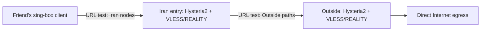

# Raah Tunnel

[English](README.md) · [فارسی](README.fa.md) · [LICENSE](LICENSE) · [CHANGELOG](CHANGELOG.md) · [ARCHITECTURE](docs/ARCHITECTURE.md) · [PROTOCOLS](docs/PROTOCOLS.md)

[](https://github.com/qasamij/raah-tunnel/actions/workflows/python-package.yml)
[](https://www.python.org/downloads/)
[](https://sing-box.sagernet.org/)
[](LICENSE)
[](https://ubuntu.com/)

If `git clone` is slow or blocked on your network, the installer automatically retries the same ref as a single HTTPS archive from `codeload.github.com`. To change that behaviour:

```bash
sudo RAAH_TARBALL_TIMEOUT=180 bash /tmp/raah-install.sh --menu   # more time for a slow link
sudo RAAH_REF=main bash /tmp/raah-install.sh --menu              # install the latest main branch
```

**A practical multi-transport gateway for Iran ↔ Outside.** Raah is the server-to-server transport layer. x-ui/3x-ui remains the owner of end-user inbounds, UUIDs, passwords, expiry, quotas, and the panel. It pairs a QUIC path for UDP-capable traffic with a TCP/REALITY fallback and health-based selection.

> Raah is an early, community-oriented project. No transport can promise immunity from blocking, detection, power loss, provider filtering, or a full network outage. Test on your own VPS and network before relying on it.

## What this first cut does

- Generates separate Outside, Iran-entry, and Linux client configurations for direct, reverse, or both topologies.
- Uses Hysteria 2 over QUIC (TCP + UDP proxy traffic) and VLESS/REALITY over TCP as independent paths.
- Scans REALITY SNI candidates and builds fallback REALITY paths; each SNI uses its own TCP port and `urltest` selects the healthier path.
- Configures automatic URL tests to choose a healthy Outside transport and Iranian entry node.
- Accepts multiple Iranian public addresses in the client profile for client-side latency selection/failover (not concurrent bandwidth distribution).
- Lets you choose ports; it never modifies x-ui or opens UFW/provider-firewall ports. When hopping is enabled, the installer maintains only Raah's isolated nftables DNAT table.
- Writes outputs with restrictive permissions and never embeds private keys in this repository.
- Includes operational helpers for UFW planning, deployment checks, host/interface traffic limits, and privacy-aware Xray/x-ui access-log reporting.
- Includes an interface byte-counter utility and a remote TCP health-check/Telegram alert helper.
- Includes an end-to-end client-profile probe through the Iran entry, Outside exit, and an HTTP(S) target.

The generated client profile is for `sing-box` clients with TUN support. Proxies carry TCP and UDP. ICMP and other arbitrary IP protocols are not transported as a full Layer-3 VPN by this proxy design.

## Quick start

This section is the shortest path from zero to a working tunnel. Follow the six
steps in order. Everything after it is optional detail.

### What you need first

| Thing | Why |
| --- | --- |
| **Two** Linux servers (VPS) | Raah is server-to-server. You cannot run it on one machine. |
| Ubuntu 22.04/24.04 on both, with `root` access | The installer creates system services. |
| A domain name **plus** a TLS certificate for the outside server | Required by Hysteria 2. A bare IP address is not enough. |
| About 20 minutes | Mostly waiting for downloads. |

You do not have to install `sing-box`, `git`, or Python yourself. The installer
pulls them in, including `sing-box` 1.14+ from its signed APT repository.

Decide which server is which, and keep the names straight:

- **Outside server** — the machine that receives your traffic and sends it out to
  the internet. Usually a cheap VPS in a nearby country.
- **Iran server** — the entry point your clients connect to. This is the machine
  in Iran, and its IP is the one your friends will point their client at.

### Step 1 — Build the config bundle

Do this **once**, on one of the two servers. It produces a matched set of files
that both servers must share, so the two halves can talk to each other.

```bash
curl -fsSL https://raw.githubusercontent.com/qasamij/raah-tunnel/main/one-click-install.sh -o /tmp/raah-install.sh
sudo bash /tmp/raah-install.sh --menu
```

Pick the option that matches the machine you are logged into right now:

| This machine is | Pick |
| --- | --- |
| the **Iran** server | **1** (IRAN server) |
| the **Outside** server | **2** (OUTSIDE server) |

The first time, no bundle exists yet and the installer asks before creating
one, because both servers must share the same keys. Answer `generate` to
continue. On the second server the bundle is already there, so the installer
reuses it instead of minting a new one. When the wizard asks:

- For "Outside server PUBLIC IP", give the **outside** server's IP.
- For "Iran server PUBLIC IP", give the **Iran** server's IP.
- If a prompt shows a value in `[square brackets]`, pressing Enter accepts it.
- If the TLS certificate domain looks wrong, type your own instead.

The files land in `/root/raah-private-bundle/`. The two you care about:

- `outside.json` → goes to the **outside** server
- `iran-01.json` → goes to the **Iran** server

### Step 2 — Put a TLS certificate on both servers

Hysteria 2 refuses to start without a valid certificate, so this is the one step
you cannot automate. Get a real certificate for your outside domain, then on
**each** server create:

```
/etc/raah/tls/fullchain.pem
/etc/raah/tls/privkey.pem
```

If you do not have a domain and certificate yet, stop here and get one first.
Nothing else will work without it.
### Step 3 — Install on the outside server

The wizard asks whether this machine should send the other server its half and
install it there. Answer `y` and it does the whole thing:

```
  Shall this machine copy them over and install them there? [y/N] y
  OUTSIDE server PUBLIC IP [203.0.113.10]:
  SSH user on that server [root]:
  Directory to place the files in on that server [/root]:
  About to do this on root@203.0.113.10:
    ...
  Continue? [y/N] y
```

Every prompt shows the value it would use anyway, so **Enter accepts it**. The
defaults come from the answers you gave in the wizard, so in the normal case the
whole exchange is `y`, Enter, Enter, Enter, `y`.

What it does, in order:

1. Checks for a usable SSH key. If there is none it offers to create one and
   prints the public half for you to add to the other server. It never asks for,
   stores or types a password.
2. Tests the login, and checks whether that server already has a TLS
   certificate, warning you first if it does not.
3. Shows you exactly what will be sent and where, and waits for `y`.
4. Copies the config **and** its `.install.json` in one `scp`, plus the
   installer itself to `/tmp/raah-install.sh`.
5. Runs `sudo bash /tmp/raah-install.sh --config ... --start` over there and
   reports what happened.

Answer `n` at the first prompt, or `Ctrl-C` anywhere, and nothing is sent. The
manual commands are printed instead:

```bash
scp /root/raah-private-bundle/outside.json /root/raah-private-bundle/outside.install.json root@OUTSIDE_IP:/root/
ssh root@OUTSIDE_IP
curl -fsSL https://raw.githubusercontent.com/qasamij/raah-tunnel/main/one-click-install.sh -o /tmp/raah-install.sh
sudo bash /tmp/raah-install.sh --config /root/outside.json --start
```

The `.install.json` is not optional: it is what enables Hysteria 2 port hopping
on this server, and without it the service still starts but the hopping range is
never redirected, so the tunnel quietly falls back to the slower path.

### Step 4 — Install on the Iran server

The same offer appears when you set up the Iran server instead, and it sends
`iran-01.json` with `iran-01.install.json` to the outside address. You only do
this once, on whichever server you set up first.

### Which half belongs on this server?

A bundle holds one config per server, and putting the wrong one in place is the
quietest mistake in the whole project. `sing-box` accepts either file, the
service starts, the tunnel comes up, and it simply never carries traffic the way
you expected — with nothing in the logs to explain why.

So the installer reads each config and works out which half it is:

| Half | Runs on | How it is recognised |
| --- | --- | --- |
| `outside.json` | Outside server (the entry) | Every outbound is `direct`, `block` or `dns` |
| `iran-01.json` | Iran server (the exit) | It carries an outbound that dials the peer |
| `client-linux.json` | Your own device | It has a `tun` inbound |

The check reads the file's own structure, so a renamed or hand-copied half is
still recognised. If the answer does not match what you said this box was, you
get a warning naming both halves. **It still installs.** Re-homing a server is a
legitimate thing to do, and a wrong guess must never be the reason a box cannot
be brought up.


### Step 5 — Open the ports

Raah never touches your firewall for you. The bundle contains a `DEPLOY.txt`
listing exactly which ports to open. On **both** servers, open those ports in
**two** places:

1. The provider's control panel (Hetzner, DigitalOcean, Contabo, …)
2. `ufw` on the machine itself

To see the list for a given config:

```bash
python3 /opt/raah-tunnel/raahctl.py firewall-plan /root/raah-private-bundle/outside.json
```

Defaults, if you never changed them: **UDP 8443** (Hysteria 2) and **TCP 7788**
outside / **TCP 8877** Iran (REALITY).

### Step 6 — Check that it works

On either server, the menu shows whether the service is alive:

```bash
sudo raah-install --menu
```

- **5** — service status
- **6** — end-to-end probe; point it at `client-linux.json` to test the
  whole path (your server → Iran → outside → the internet). This is the check
  that tells you the tunnel genuinely carries traffic.

Then copy `client-linux.json` from `/root/raah-private-bundle/` to the device
that will use the tunnel. It is for a `sing-box` client with TUN support.

### If something goes wrong

| Symptom | Try |
| --- | --- |
| `Could not download ... over git or HTTPS` | The installer already retried over an archive. Check this server's internet. |
| Service will not start | Option 5. A missing TLS certificate is the usual cause. |
| Probe fails but services are up | Ports are not open, or the client file is stale. |
| Everything worked on another network but not yours | Open **both** TCP and UDP for the full port range. |

## Everything else

You do not need any of this to get running. It is here when you outgrow the
steps above.

### Generate different topologies

```bash
python3 raahctl.py generate --mode direct --out ./private-bundle
python3 raahctl.py generate --mode reverse --out ./private-reverse
python3 raahctl.py generate --mode both --out ./private-both
```

Let the tool suggest a REALITY SNI pool:

```bash
python3 raahctl.py sni-scan
python3 raahctl.py generate --auto-sni --sni-pool-size 3 --out ./private-bundle
```

The wizard asks for the Outside address, one or more Iranian entry addresses, ports, REALITY handshake names, and certificate paths. It produces:

- `outside.json`
- `outside.install.json` (server-side port-hopping/DNAT metadata)
- `iran-01.json`, `iran-02.json`, … (one matching config per Iran entry node)
- `iran-01.install.json`, `iran-02.install.json`, …
- `client-linux.json`
- `DEPLOY.txt` with the exact ports and safe deployment commands

Reverse mode creates `reverse-outside-entry.json`, `reverse-iran-exit-01.json`, their matching `.install.json` files, and `reverse-client-linux.json`. Mode `both` creates separate `direct` and `reverse` directories. Keep each server JSON and matching install metadata together when copying or installing it.

For a manual install, copy the script and the matching private config to each host. Run separately:

**Outside server:**

```bash
cd /opt/raah-tunnel
sudo bash scripts/install-unit.sh /root/raah-private-bundle/outside.json
sudo systemctl enable --now raah-sing-box
```

**Iran server:**

```bash
cd /opt/raah-tunnel
sudo bash scripts/install-unit.sh /root/raah-private-bundle/iran-01.json
sudo systemctl enable --now raah-sing-box
```

On a second Iran host use its own `iran-02.json`. After replacing an existing config, run `sudo systemctl restart raah-sing-box`.

The helper does not open firewall ports or restart x-ui. For port hopping it does maintain an isolated `raah_porthop` nftables DNAT table; allow the complete UDP range separately in UFW and the VPS provider firewall.

The default Outside REALITY base port is TCP/7788 and the default Iran REALITY base port is TCP/8877. If you enter several SNIs, Raah uses the next ports in order, for example Outside `7788, 7789, 7790` and Iran `8877, 8878, 8879`.

Advanced mode asks for separate Outside/Iran `urltest` URLs and the health interval. The default URL is `https://cp.cloudflare.com/generate_204`; use menu option 7 to change it if that endpoint is unreliable on either real path. Use `10s` for more aggressive failover checks or the calmer default `15s`.

## IPv6

Raah works over IPv6, and this is a tested property rather than an assumption.
The generator accepts an IPv6 literal anywhere it accepts a hostname, every
server inbound listens on `::` (dual-stack on Linux, so the same port serves
both families), the nftables port-hopping table is in the `inet` family so one
ruleset redirects Hysteria 2 hops for IPv4 and IPv6 alike, and the client
profile already carries a ULA.

What IPv6 does **not** give you is redundancy between address families. Each
Iran node and the Outside server hold exactly one address, and the `urltest`
groups select between nodes, not between address families. A server with both an
IPv4 and an IPv6 address is reachable over whichever one you recorded; the other
is not used as a fallback. To get cross-family failover, list the same server
more than once with each address, which is a deliberate operator decision rather
than automatic behaviour.

Practical notes:

- Enter the literal bare: `2001:db8:122::10`, not `[2001:db8:122::10]`. The
  wizard strips brackets if you paste them, and it stores what is left.
- A bare IPv6 address cannot carry a Hysteria 2 TLS certificate. With
  IPv6-only, use a domain name for the certificate, or a certificate that
  carries an IP SAN.
- `ufw allow <port>/tcp` and `ufw allow <port>/udp` cover both families as long
  as `IPV6=yes` in `/etc/default/ufw`. Your VPS provider firewall is separate
  and must allow IPv6 too.
- `sing-box check` in CI validates an IPv6 bundle alongside the IPv4 one, and
  `tests/test_ipv6.py` asserts the properties above.

## Design



Iran and Outside run independent `sing-box` services under `/etc/raah`; x-ui's files and service are left alone. If x-ui already owns a chosen port, select different ports before generating configs. Client `urltest` selects a best reachable entry for that client; it does not distribute multiple clients evenly across nodes. Health selection affects new connections; existing sessions can drop during a path change and reconnect.

## Commands

```bash
python3 raahctl.py generate --out ./private-bundle
python3 raahctl.py validate ./private-bundle/outside.json
python3 raahctl.py validate ./private-bundle/iran-01.json
python3 raahctl.py validate ./private-bundle/client-linux.json
python3 raahctl.py sni-scan
python3 raahctl.py stats --interface eth0
python3 raahctl.py quota-check --interface eth0 --limit-gb 500
python3 raahctl.py status --interface eth0
python3 raahctl.py doctor ./private-bundle
python3 raahctl.py list-users ./private-bundle/iran-01.json
python3 raahctl.py add-user ./private-bundle/iran-01.json --name ali --expires-at 2026-12-31T23:59:00Z --quota-gb 50 --out ./iran-01.with-ali.json
python3 raahctl.py enforce-users ./iran-01.with-ali.json
python3 raahctl.py revoke-user ./private-bundle/iran-01.json --user friends --out ./iran-01.revoked.json
python3 raahctl.py firewall-plan ./private-bundle --ssh-port 22
python3 raahctl.py probe --host ir-entry.example.net --port 8877 --count 20
python3 raahctl.py e2e-probe ./private-bundle/client-linux.json --count 5
python3 raahctl.py check --host ir-entry.example.net --port 8877 --telegram-env
python3 raahctl.py watch --host ir-entry.example.net --port 8877 --interval 30 --telegram-env
```

User lifecycle and quotas belong in x-ui/3x-ui. The legacy `add-user`, `list-users`, `revoke-user`, and `enforce-users` commands remain only for old bundles and must not become a second user database. `audit-report` aggregates Xray/x-ui access-log metadata by user and destination without inspecting payloads. For HTTPS this normally means a domain/SNI, not the full URL path or page content. `doctor` checks generated configs, `firewall-plan` prints UFW commands, and `stats`/`quota-check` report host-wide interface totals rather than per-user billing.

`e2e-probe` validates a generated client profile, starts a temporary mixed/SOCKS listener bound only to `127.0.0.1`, and sends HTTP(S) requests through the complete configured route. Use `--outbound TAG` to test one transport; omit it to test the configured final/urltest selection. Run it from the real client network for meaningful results.

`edit-bundle` interactively updates addresses, transport ports, per-side REALITY SNI pools, per-side health URLs, the failover interval, and Hysteria2 hopping. It locks the bundle, creates a private timestamped backup, keeps only the newest three backups, preserves keys and credentials, and regenerates all matching server, metadata, and client files from `secrets.json`. Reinstall each affected server JSON together with its matching `.install.json`, then redistribute updated client profiles.

The health interval is menu item 12, and `--health-interval` does the same thing
without the prompts:

```bash
python3 raahctl.py edit-bundle /root/raah-private-bundle --health-interval 45s
```

It rewrites the `interval` of every `urltest` group in every regenerated file, so
the two sides cannot end up failing over at different speeds. Values are Go
durations (`ms`, `s`, `m`, `h`); `0s` is rejected, because an interval of zero
makes sing-box hammer the health URL instead of failing over. There is no lower
bound worth enforcing beyond that, so `10s` stays a reasonable choice.

After the first installation, open the menu with `sudo raah-install --menu`. Option 8 updates to the newest published stable `v*` tag. Option 9 removes the Raah service, `/etc/raah`, the installed checkout and launcher after an explicit confirmation; deletion of `/root/raah-private-bundle` requires a second confirmation. The shared sing-box package is intentionally retained.

## Security and operating notes

- Never put generated JSON, certificates, private keys, passwords, or client profiles in GitHub. `.gitignore` blocks the default output folder.
- Use a different Hysteria password, Salamander password, UUID, and REALITY key set for each deployment.
- Bind admin/monitoring services to loopback or a private management network. Raah exposes no public management API.
- Explicitly allow only the configured TCP and UDP ports in the provider firewall and host firewall.
- Set accurate bandwidth ceilings only after measuring the real path. Overstating a cap can increase loss and jitter.
- SNI scan results are local to the machine running the scan. For better choices, run `sni-scan` from Iran and Outside. With multiple SNIs, sing-box uses `urltest` to move new connections to another REALITY path when one path degrades.
- Cloudflare/Arvan DNS can help publish or change DNS answers; DNS alone cannot keep a live session alive after a server or route fails. Client-side health selection needs all entry addresses in the profile.
- Cloudflare's ordinary orange-cloud HTTP proxy is not a generic Hysteria/QUIC forwarder. Use direct DNS resolution for Hysteria endpoints. REALITY is not a cure-all and its handshake target must be reachable and configured correctly.
- Direct mode means clients enter through Iran and Outside exits. Reverse mode means clients enter through Outside and one Iran server exits. If you run both modes on the same host at the same time, change one mode's ports first.
- Client profiles use sing-box 1.14 TUN DNS hijacking and encrypted DoH through the selected tunnel path. Legacy top-level FakeIP syntax was removed in sing-box 1.14, so Raah does not emit that obsolete block.
- Hysteria2 port hopping is coordinated end to end. The client receives `server_ports`/`hop_interval`; the matching `.install.json` makes a separate `raah-port-hop` systemd service install an isolated nftables DNAT table. You must still open the complete UDP range shown in `DEPLOY.txt` in the VPS provider firewall.
- A TCP fallback can carry UDP-based application data through proxy packet encoding, but it adds latency and head-of-line effects. For real-time games, it is a survival path, not equivalent to a working UDP path.

## Scope and roadmap

This release is a transport/config generator and operations toolkit, not a hosted control panel. Enable Xray access logs in x-ui only with user notice, keep them mode `600`, rotate them, and use a short retention period. `audit-report` summarizes metadata; it does not capture message bodies or forward raw browsing logs to Telegram.

## License

MIT. See [LICENSE](LICENSE).
